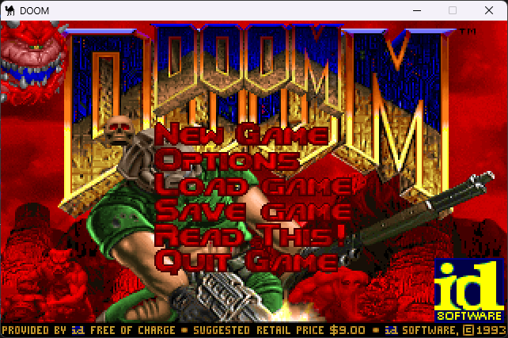

# perl_doom



**Video:** [DOOM running in Perl](https://youtu.be/VN-lWDOsYrg)

**Repository:** [github.com/vagucs/perl_doom](https://github.com/vagucs/perl_doom)

DOOM generic ported from **[python_doom](https://github.com/vagucs/python_doom)** to **Perl 5.44 + SDL2**.

By **Wagner Nunes da Silva**

- vagucs@bol.com.br
- vagucs@vagucs.com.br
- vagucs@gmail.com
- [www.vagucs.com.br](https://www.vagucs.com.br)
- [LinkedIn](https://www.linkedin.com/in/wagner-nunes-da-silva-b0a15360)

The game stays in Perl. `SDL2.dll` opens the window. This port has no C source of its own. This step reads an IWAD, shows the title picture, and enters the E1M1 view. Map things appear, walls hold the player back, Space opens a door, a grate shows what is behind it, and Ctrl fires the pistol. A monster sees, walks, and fights back. Health, ammo, armor, keys, and the shotgun leave the floor.

Versão em português: [README.pt.md](README.pt.md)

---

## What this project is

`python_doom` is a condensed, playable DOOM engine in Python. This directory starts the **same study piece**, in Perl:

- Window and keys: **SDL2**, reached through `Win32::API` (cdecl). The engine does not live in that bridge
- Framebuffer: 320×200, stretched to a 640×400 window
- 16.16 fixed-point: `Doom/Compat.pm`, the same math as `doom/compat.py`. A Perl integer is 8 bytes
- IWAD: `Doom/Wad.pm`

At this step the program checks the fixed-point helpers, reads the IWAD, and draws `TITLEPIC`. Enter starts the map (E1M1, or MAP01 on Doom 2). The arrow keys turn and walk. Shift runs. The body stops at a wall and slides along it. A step taller than 24 units, or a gap shorter than the player, also blocks. Barrels, monsters, and items show in the frame they spawn in. Solid ones stop the step. Space opens the door ahead: the ceiling rises, a normal door waits and then closes, and a door that stays open does not come back down. A locked door opens once the key from the floor is in hand. Walking over an item restores health, adds bullets, or puts on armor. Armor absorbs part of the damage. A grate shows the far side, and what stands behind it stays behind the bars. Ctrl fires the gun in hand. The pistol recoils and spends one bullet. Whatever is ahead loses health, flinches, or falls. A barrel explodes. A zombie, an imp, and a demon wake when they see the player: they walk up, the zombie shoots, the imp throws a fireball, and the demon bites up close. Key 1 returns to the pistol and key 2 selects the shotgun and key 3 selects the chaingun. Ctrl fires the gun in hand: the shotgun spends one shell and throws seven pellets. The chaingun spends one bullet per shot and keeps firing while Ctrl is held. Key 4 selects the rocket launcher picked up from the floor. Each shot spends one rocket and it explodes on impact. Key 5 selects the plasma rifle picked up from the floor on Doom 2. Each shot spends one cell and throws a bolt that burns on impact. Key 6 selects the BFG, also on Doom 2. Each shot spends 40 cells, launches the big ball, and the blast sweeps whoever is in front. Key 7 is the chainsaw, key 8 the super shotgun, and key 9 the fist. In a level, iddqd, idkfa, idfa, idclip, idspispopd, idchoppers, idclev, idmus, iddt, and idbehold are on. On the floor, the invulnerability sphere, berserk pack, invisibility, radiation suit, computer map, and light visor go into the inventory. A teleport line sends you to its marker, with fog and your face turned toward the exit. A one-shot line goes away; a repeating line stays. A line 48 wall keeps sliding its texture sideways. Running from one high platform toward another, the body falls gradually and can still reach the far floor. Crossing line 2 opens a door and leaves it open, line 3 closes it, and line 4 opens it and then closes it. Line 8 builds a stair: the tagged floor rises, and each neighboring room with the same floor rises one step higher. Line 100 builds the same stair with taller steps and a faster rise. Line 10 lowers the floor to the lowest neighbor, waits, and brings it back up. The line goes away afterward. The other floors, ceilings, crushers, lifts, stairs, and lights on the map lines move as well. The title opens the menu. In options, resolution changes the window size and screen size changes the view. The - and + keys change the screen size. Alt strafes, comma and period step sideways, and the mouse turns and looks. Pause pauses. Nightmare speeds the monsters up and brings them back. The backpack also fills shells, rockets, and cells. A closed door, seen from a lower floor, still hides the monster standing behind it. The shot, the door, the item, and the monster make a sound. The title and the map play their music. The bar along the bottom shows health, ammo, armor, the face, and keys. The exit switch changes its picture. A floor drops when the line is crossed, and the lift goes down and back up. The slime takes health and the lights blink. At the end of a map the tally opens the next one, keeping health, ammo, and armor. On the second map a switch opens the door and the lift, and a shot into the wall opens the way too. The screen melts between the end of a level and the next map. At the end of the episode the story types onto the floor, the next picture comes in, and a key returns to the title. On episode 3 the bunny scrolls across and takes the shots. In Doom 2 the text between maps continues the game, and map 30 opens the monster cast. A shot wakes the monsters in the room even when it misses. The first door of Doom 2's second map opens when you walk across it. The switch in the antechamber lowers the floor and the passage opens. Tab shows the walls already seen, and + and - zoom. Enter on the title opens the difficulty: the easiest takes half damage and starts the pistol with twice the bullets; nightmare makes monsters shoot more often. Registered Doom asks for the episode first. F2 saves the game and F3 loads it, in six slots. Esc, or closing the window, quits.

You need a legal IWAD (shareware `doom1.wad` or commercial `doom.wad` / `doom2.wad`). This repository does not ship commercial WAD data.

---

## Educational purpose

The Python port already dropped the preprocessor and Harbour's 1-based arrays. The Perl port asks what changes when the lists stay 0-based and the 32-bit math fits in an 8-byte integer, with no C file.

- **Python, then Perl.** Open `python_doom/doom/` next to `perl_doom/Doom/`.
- **Wrap, written down.** `as_i32` brings a 16.16 product back to 32 bits.
- **Where Perl is enough.** The WAD directory, the patch, and the loop stay in Perl. SDL2 is the window.

---

## From Python to Perl

| Python (`python_doom`) | Perl (`perl_doom`) |
| --- | --- |
| `thing.x` | `$thing->{x}` |
| `None` | `undef` |
| `items[0]` | `$items[0]` |
| class | `package` and a blessed hash |
| unbounded `int` | 8-byte integer; `as_i32` cuts it to 32 bits |
| `fixed_mul` | `fixed_mul` |
| framebuffer `bytearray` | a byte string |
| pygame | SDL2 through `Win32::API` |

---

## Technology

| Layer | This port | Python (`python_doom`) |
| --- | --- | --- |
| Language | Perl 5.44, `C:\msys64\ucrt64\bin\perl.exe` | Python 3.10+ |
| Window | SDL2, `Win32::API` | pygame 2.x |
| 16.16 fixed-point | `Doom/Compat.pm` | `doom/compat.py` |
| IWAD | `Doom/Wad.pm` | `doom/wad.py` |

The Cygwin Perl (`C:\msys64\usr\bin\perl.exe`) does not fit: it must not load this `SDL2.dll`. `run.bat` puts `C:\msys64\ucrt64\bin` at the front of `PATH`.

---

## How to run

From this directory, on Windows:

```
run.bat
run.bat -fps -novsync
```

`-iwad` chooses the file. A bare path ending in `.wad` also works. `-fps` draws the frames per second in the upper right. `-novsync` presents without waiting for the monitor.

The IWAD search starts at `DOOMWADDIR` or `DOOMWADPATH` when that variable is set, then the current folder, this program's folder, and the parent folders. The shareware `DOOM1.WAD` in the parent folder is on that list.

---

## Keys

| Key | Action |
| --- | --- |
| **Enter** | Confirm the menu item |
| **Left / right arrow** | Turn |
| **Up / down arrow** | Walk. Shift runs |
| **Space** | Open the door ahead |
| **Ctrl** | Fire the gun in hand |
| **1** | Pistol |
| **2** | Shotgun |
| **- / +** | Screen size |
| **Esc** | Opens the menu. On the title, quits |
| **Alt+Enter** | Full screen |
| **Alt** | Strafe |
| **, / .** | Sidestep |
| **Mouse** | Turn and look. Button fires |
| **Pause** | Pause |
| Close the window | Quit |

---

## Layout

```
main.pl              entry, title, view, collision, things, doors, and shots
Doom/Compat.pm       doom/compat.py
Doom/Wad.pm          doom/wad.py
Doom/Tables.pm       doom/tables.py
Doom/RData.pm        doom/r_data.py
Doom/World.pm        doom/world.py
Doom/Collision.pm    doom/collision.py
Doom/Render.pm       doom/render.py
Doom/Info.pm         doom/info.py
Doom/Sprites.pm      doom/sprites.py
Doom/Specials.pm     manual doors from doom/specials.py
Doom/Attack.pm       pistol from doom/player.py
Doom/Enemy.pm        monsters from doom/enemy.py
Doom/Pickups.pm      floor items from doom/mobj.py
Doom/Sound.pm        effects and music from doom/sound.py
Doom/Status.pm       bar from doom/status.py
Doom/Wi.pm           tally from doom/wi_stuff.py
Doom/Wipe.pm         melt from doom/wipe.py
Doom/Finale.pm       story from doom/finale.py
Doom/Automap.pm      Tab map from doom/am_map.py
Doom/Menu.pm         difficulty from doom/menu.py
Doom/Save.pm         save and load from doom/saveg.py
Doom/Mus.pm          MUS to MIDI from doom/mus2mid.py
Doom/VVideo.pm       doom/v_video.py
Doom/Video.pm        SDL2 window
Doom/Defs.pm         screen size and FRACUNIT
run.bat              UCRT64 Perl 5.44
```

---

## Lineage

1. **[python_doom](https://github.com/vagucs/python_doom)** — Python + pygame
2. **[perl_doom](https://github.com/vagucs/perl_doom)** — Perl 5.44 + SDL2 (this tree)

---

## Donate

### GitHub Sponsors

[github.com/sponsors/vagucs](https://github.com/sponsors/vagucs)

### Ethereum

`0x1b64038A2b1DB73ABd0068d8B9B0d1dC5a90C5F1`


### PIX

Key: `vagucs@bol.com.br`


